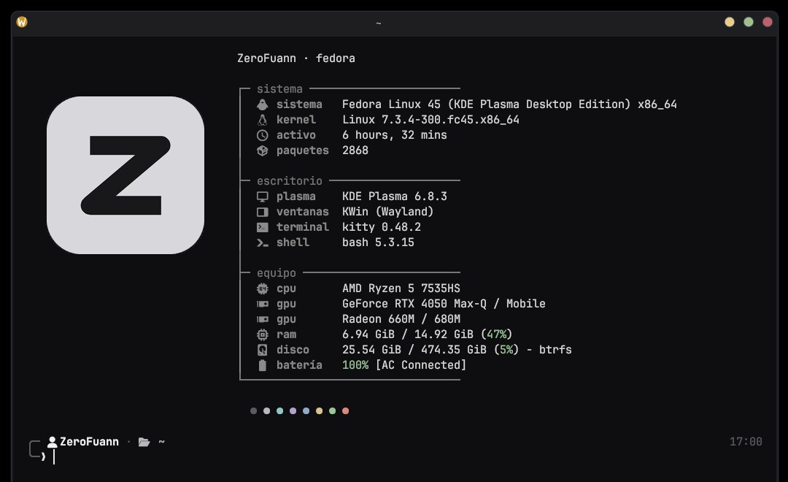
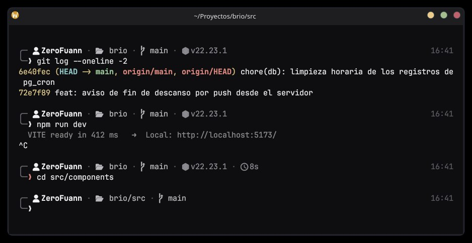
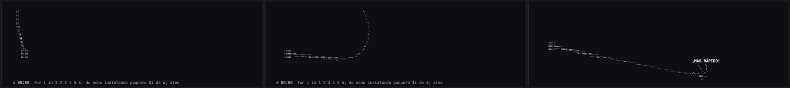
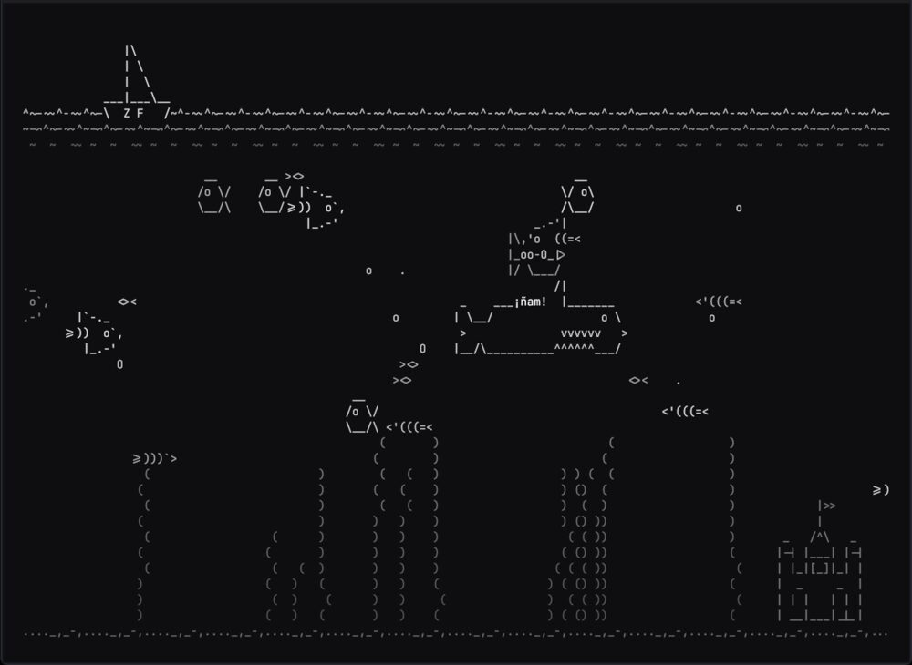
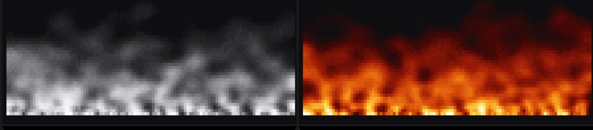
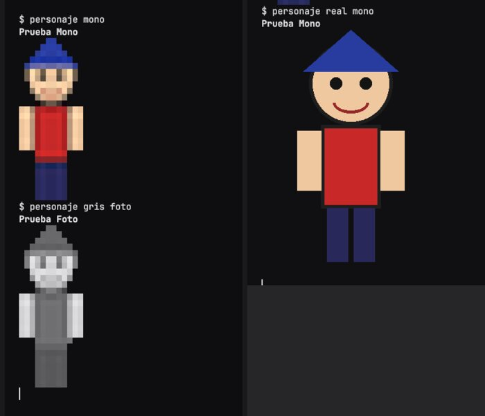

<div align="center">


# dotfiles · Terminal Carbon

**Mi terminal en Fedora + KDE Plasma: kitty en grises, herramientas modernas y scripts propios para trabajar y para lucirse.**

kitty · bash · starship · fastfetch · Python

</div>

<p align="center"></p>

## Qué trae

Todo sigue el mismo estilo **Carbon**: fondo casi negro, texto en escala de grises, sin colores chillones. Los scripts de `bin/` los escribí yo en Python, sin dependencias raras (solo `personaje` usa Pillow).

### Para trabajar

| Comando | Qué hace |
|---|---|
| prompt | starship estilo árbol: usuario, carpeta, rama de git, versión de Node, duración y hora |
| `ls` · `ll` · `la` · `lt` | eza en gris con líneas de árbol, git y fechas relativas |
| `z brio` · `zi` | zoxide: salta a la carpeta más usada que coincida |
| Ctrl+R · Ctrl+T · Alt+C | fzf: historial, archivos y carpetas con vista previa (bat / eza) |
| `top` | btop con tema Carbon |
| `gg` | lazygit; fuera de un repo te deja elegir proyecto con fzf |
| `y` | yazi; al salir te deja en la carpeta donde ibas |
| Meta+Enter | kitty que baja desde arriba (quick-access-terminal) |
| Ctrl+Shift+D / B | dividir a la derecha / abajo; Alt+flechas para moverte |
| aviso | notificación de KDE cuando un comando de más de 15 s acaba y estás en otra ventana |
| `musica` | spotify_player con tema Carbon |
| `clima` | pronóstico de wttr.in en ASCII, pasado a grises (`clima hoy`, `clima corto`, `clima luna`) |
| `reloj` | hora gigante, `reloj crono` y `reloj 25m` (temporizador con notificación y sonido) |
| `frase` | frase del día al abrir kitty (código, motivación, MCU, manga, Barça…) |

<p align="center">


</p>
<p align="center">


</p>

### Para lucirse

| Comando | Qué hace |
|---|---|
| `apurale <comando>` | Un látigo en braille con física y sonido que da latigazos mientras corre tu comando; al final te dice cuánto tardó |
| `ondas` | cava: barras que bailan con lo que suene |
| `lluvia` | Lluvia tipo Matrix en grises, con mensajes escondidos (`lluvia -z`) |
| `acuario` | Acuario propio: peces, burbujas, algas, castillo, barco y un tiburón que se come peces |
| `fuego` | Fogata animada en gris o a colores (`fuego -c`) |
| `poke` | Pokémon con [pokeget](https://github.com/talwat/pokeget-rs): a colores, en gris y el juego `poke quien` |
| `personaje` | Cualquier imagen tuya de `~/Imágenes/terminal/` en pixel art, en gris o real; incluye `personaje quien` |

<p align="center">


</p>
<p align="center">


</p>
<p align="center">


</p>

Todos los scripts traen ayuda: `apurale -h`, `reloj -h`, `personaje -h`…

## Instalar

```bash
git clone https://github.com/ZeroFuann-FS/dotfiles.git
cd dotfiles
./instalar.sh
```

- Copia todo a su lugar (`~/.config`, `~/.local/bin`, `~/.bashrc.d`) y **respalda** lo que ya tengas como `*.antes-dotfiles`.
- No usa `sudo`: al final te dice qué programas te faltan y el comando para instalarlos.
- Tus datos personales van en `~/.bashrc.d/00-privado.sh`, que no forma parte del repo:

```bash
export CLIMA_CIUDAD="Tu ciudad"   # vacío = wttr.in la detecta por tu IP
export MASCOTA="nombre"           # imagen de ~/Imágenes/terminal que sale chiquita al abrir kitty
```

**Requisitos:** kitty reciente (la terminal desplegable usa `kitten quick-access-terminal`), la fuente JetBrains Mono, Python 3 y, para el látigo, PipeWire (`pw-play`). Probado en Fedora 45 con KDE Plasma 6.

## Estructura

```
bin/       scripts (apurale, lluvia, acuario, fuego, reloj, clima, frase, poke, personaje, zfetch…)
bash/      alias y funciones (~/.bashrc.d)
kitty/     kitty.conf, tema carbon.conf y la terminal desplegable
config/    starship, fastfetch, btop, lazygit, yazi, cava, spotify_player
share/     frases, sonido del látigo, lanzador de la terminal desplegable
```

## Créditos

Inspirado en proyectos como badclaude y OpenWhip (el látigo), cmatrix, asciiquarium y tty-clock. El código de `bin/` es propio. Los sprites de Pokémon los dibuja pokeget y no vienen en este repo.

## Licencia

[MIT](LICENSE) © ZeroFuann
