<div align="center">

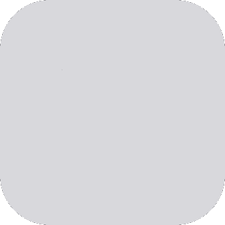

# Terminal Carbon

**Mi terminal y mi escritorio en Fedora + KDE Plasma: kitty en escala de grises, herramientas modernas,<br>scripts propios en Python y 11 widgets de Plasma hechos a mano.**


[Instalar](#instalar) · [Para trabajar](#para-trabajar) · [Para lucirse](#para-lucirse) · [Personalizar](#personalizar) · [Escritorio](#escritorio-kde-plasma) · [Estructura](#estructura)

<br>


</div>

## Instalar

```bash
git clone https://github.com/ZeroFuann-FS/dotfiles.git
cd dotfiles
./instalar.sh
```

1. Copia todo a su lugar: `~/.config`, `~/.local/bin` y `~/.bashrc.d`.
2. Lo que ya tengas lo **respalda** como `archivo.antes-dotfiles` antes de reemplazarlo.
3. No usa `sudo`: al final te dice qué programas te faltan y el comando para instalarlos.
4. Abre una kitty nueva y listo.

> **Requisitos:** kitty reciente, la fuente JetBrains Mono, Python 3 y PipeWire (`pw-play`) para los sonidos. Probado en Fedora 45 con KDE Plasma 6.

## Para trabajar

| Comando | Qué hace |
|---|---|
| **prompt** | starship estilo árbol: usuario, carpeta, rama de git, Node, duración y hora |
| `ls` · `ll` · `la` · `lt` | eza en gris con líneas de árbol, estado de git y fechas relativas |
| `z <algo>` · `zi` | zoxide: salta a la carpeta más usada que coincida |
| `Ctrl+R` · `Ctrl+T` · `Alt+C` | fzf: historial, archivos y carpetas con vista previa |
| `top` | btop con tema Carbon |
| `gg` | lazygit; fuera de un repo eliges el proyecto con fzf |
| `y` | yazi; al salir te deja en la carpeta donde ibas |
| `Meta+Enter` | kitty que baja desde arriba de la pantalla |
| `Ctrl+Shift+D` · `Ctrl+Shift+B` | dividir a la derecha o abajo; `Alt+flechas` para moverte |
| *automático* | notificación de KDE cuando un comando de más de 15 s acaba y estás en otra ventana |
| `musica` | Spotify en la terminal (spotify_player, necesita Premium) |
| `clima` | pronóstico de wttr.in en ASCII pasado a grises · `clima hoy` · `clima corto` · `clima luna` |
| `reloj` | hora gigante · `reloj crono` · `reloj 25m` temporizador con aviso y sonido |
| `frase` | frase del día al abrir kitty · `frase otra` · `frase barca` · `frase + "tuya"` |

<table>
  <tr>
    <td width="50%"></td>
    <td width="50%">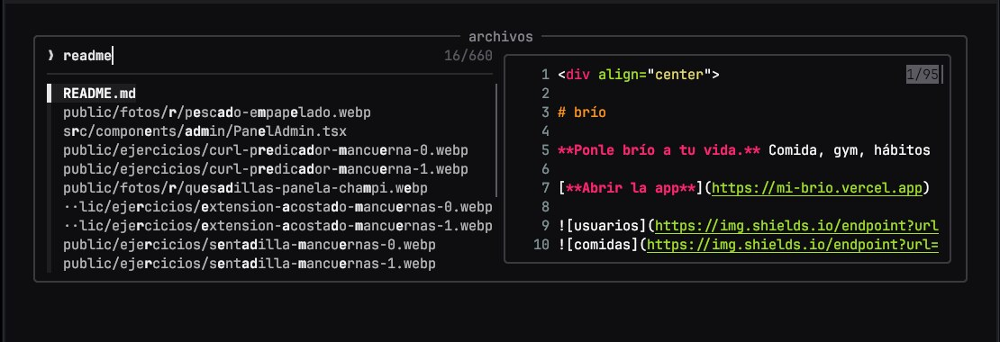</td>
  </tr>
  <tr>
    <td width="50%">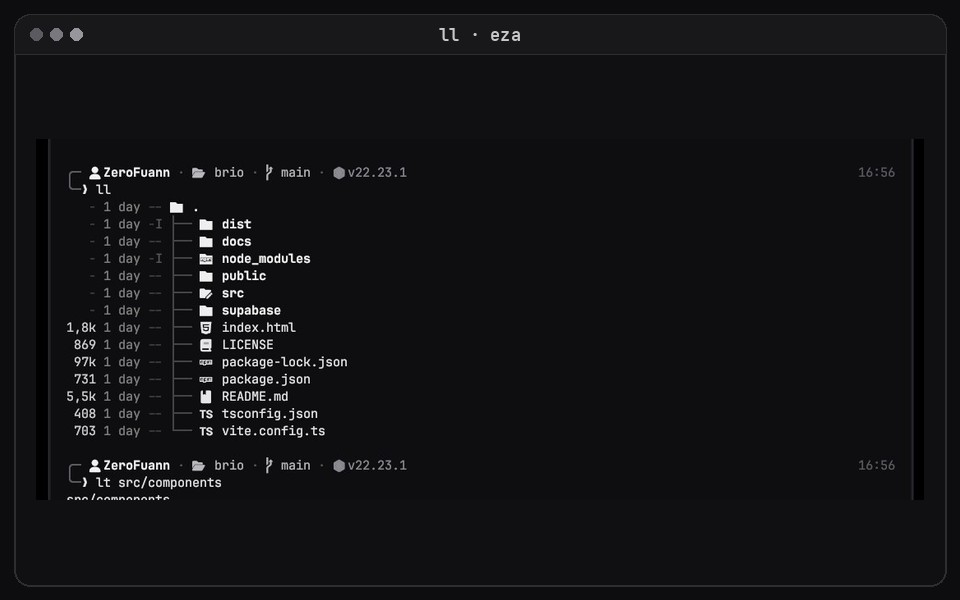</td>
    <td width="50%">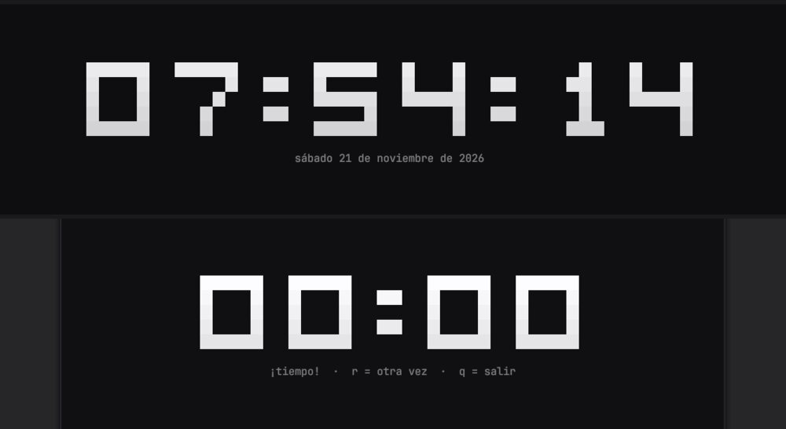</td>
  </tr>
</table>

## Para lucirse

| Comando | Qué hace |
|---|---|
| `apurale <comando>` | Un látigo en braille con física y sonido que da latigazos mientras corre tu comando; al final te dice cuánto tardó |
| `lluvia` | Lluvia tipo Matrix en grises · `lluvia -z` con mensajes escondidos |
| `acuario` | Peces, burbujas, algas, castillo, barco y un tiburón que se come peces · `Espacio` echa más |
| `fuego` | Fogata animada en gris · `fuego -c` a colores · `←` `→` viento |
| `ondas` | cava: barras que bailan con lo que suene |
| `poke` | Pokémon con [pokeget](https://github.com/talwat/pokeget-rs) · `poke gris` · `poke quien` para adivinar |
| `personaje` | Cualquier imagen tuya en pixel art, en gris o real · `personaje quien` para adivinar |

<table>
  <tr>
    <td width="50%"></td>
    <td width="50%">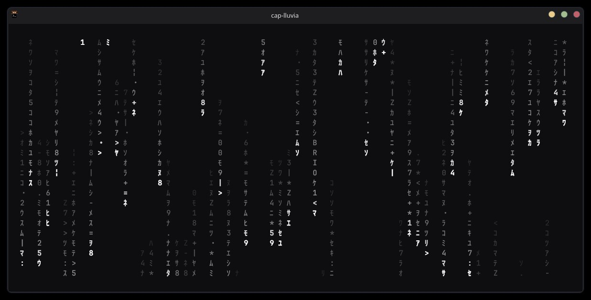</td>
  </tr>
  <tr>
    <td width="50%"></td>
    <td width="50%"></td>
  </tr>
  <tr>
    <td width="50%">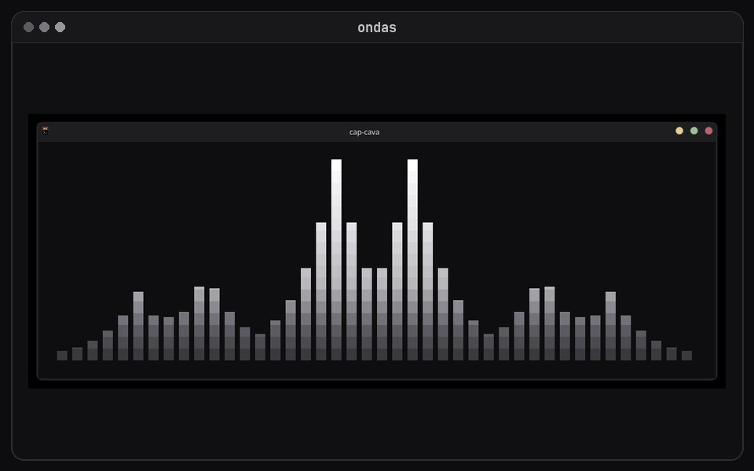</td>
    <td width="50%"></td>
  </tr>
</table>

Todos los scripts traen ayuda: `apurale -h`, `reloj -h`, `personaje -h`…

## Personalizar

Tus datos personales van en `~/.bashrc.d/00-privado.sh`. El instalador lo crea vacío y no forma parte del repo:

```bash
export CLIMA_CIUDAD="Tu ciudad"   # vacío = wttr.in la detecta por tu IP
export MASCOTA="nombre"           # imagen que sale chiquita junto a la frase al abrir kitty
```

- **Personajes:** pon tus imágenes en `~/Imágenes/terminal/` (subcarpetas `anime/`, `marvel/`, `otros/`…). El nombre del archivo es el del personaje: `mi-perro.png` sale como «Mi Perro».
- **Frases:** edita `~/.local/share/frases/frases.txt` (una por línea: `tema|frase|autor`) o usa `frase + "texto — autor"`.
- **Colores:** el tema vive en `kitty/carbon.conf`; los demás programas usan los mismos grises.

<p align="center">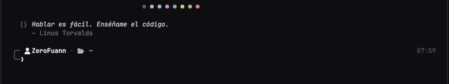</p>

## Escritorio (KDE Plasma)

<p align="center">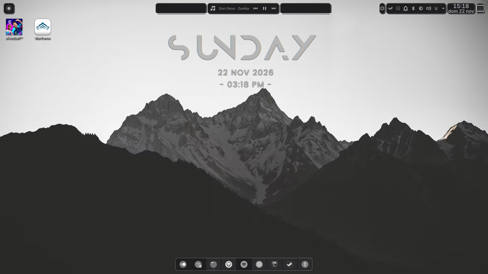</p>

Barra flotante arriba con lanzador, música, centro de control y bandeja; un dock abajo **en cada pantalla** (laptop y monitor) y todo en grises con el preset **Carbon** de Panel Colorizer.

```bash
cd dotfiles/kde
./instalar-kde.sh            # widgets, fondo-pausa (Meta+P) y tema de Spotify
./instalar-kde.sh --paneles  # además, mis paneles (respalda los tuyos antes)
```

### Widgets hechos a mano

<table>
<tr>
<td width="33%">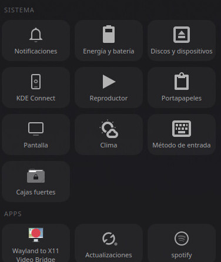<br><b>Estado</b> · el menú de la bandeja en mosaicos animados</td>
<td width="33%">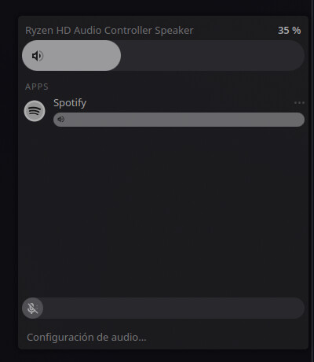<br><b>Sonido</b> · volumen con nivel en vivo, por app y salida</td>
<td width="33%">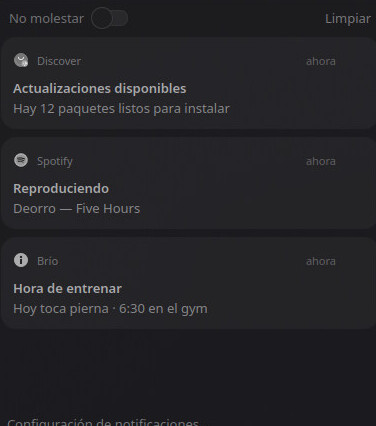<br><b>Notificaciones</b> · historial y No molestar</td>
</tr>
</table>

| Widget | Qué hace |
|---|---|
| **Wi-Fi** | Redes con su señal; conectar y desconectar sin salir del panel |
| **Bluetooth** | Tus dispositivos emparejados con un toque |
| **Sonido**, **Notificaciones**, **Estado** | Reemplazos de los de Plasma con otro diseño |
| **Reloj**, **Clima**, **Música**, **Sistema** | Tarjetas para el escritorio: hora y temperatura, pronóstico de 4 días (Open-Meteo), reproductor y CPU/GPU/RAM |
| **Barras** y **Esfera** | Visualizadores que bailan con la música (necesitan el relay de [plaintop](https://github.com/highscrren-dotcom/plaintop)) |

`fondo-pausa` (Meta+P) pausa el fondo animado cuando hay ventanas encima: el uso de CPU de Plasma bajó de 47 % a 26 % de un núcleo.

> Al final, `instalar-kde.sh` te dice qué widgets de la KDE Store faltan (Panel Colorizer, Andromeda Launcher, Plasma Flex Hub…). Los fondos animados son de Wallpaper Engine y no vienen en el repo.

## Estructura

```
dotfiles/
├── bin/        scripts: apurale, lluvia, acuario, fuego, reloj, clima, frase, poke, personaje, zfetch
├── bash/       alias y funciones para ~/.bashrc.d
├── kitty/      kitty.conf, tema carbon.conf y la terminal desplegable
├── config/     starship, fastfetch, btop, lazygit, yazi, cava, spotify_player
├── share/      frases, sonido del látigo y lanzador de la terminal desplegable
├── kde/        11 widgets de Plasma, paneles, fondo-pausa, tema de Spotify e instalar-kde.sh
└── instalar.sh
```

## Créditos

Ideas inspiradas en cmatrix, asciiquarium, tty-clock y en los "látigos para la terminal" (badclaude, OpenWhip). El código de `bin/` y los widgets de `kde/widgets/` son propios. Los sprites de Pokémon los dibuja pokeget y no vienen en este repo.

<div align="center">

<br>

[MIT](LICENSE) · hecho por **ZeroFuann**

</div>
